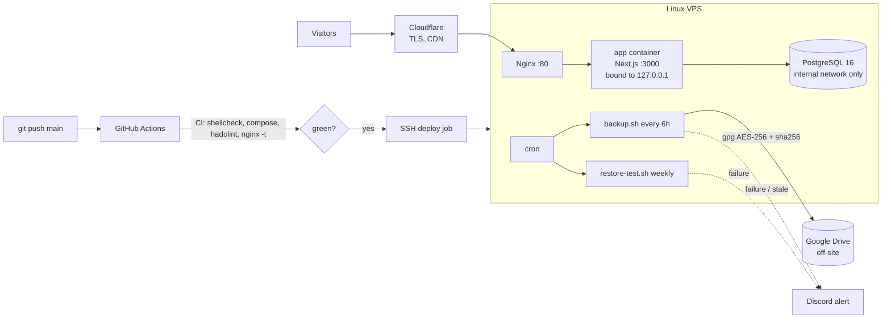

# production-vps-cicd

[](https://github.com/Rabbii96/production-vps-cicd/actions/workflows/ci.yml)

The deployment, backup and recovery setup I run in production for a live e-commerce site
(Next.js + PostgreSQL) on a single Linux VPS — extracted from the real project with secrets,
IPs and business code removed.

**What it shows:** CI/CD with GitHub Actions · Docker Compose · Nginx behind Cloudflare ·
health-checked deploys with automatic rollback · encrypted off-site backups · a weekly
*automated restore test* (because a backup you have never restored is only a hope).

---

## Architecture



## How a deploy works

1. **CI** (`.github/workflows/ci.yml`) runs on every push: ShellCheck on all scripts,
   `docker compose config`, hadolint on the Dockerfile, `nginx -t` on the site config.
2. **Deploy** (`.github/workflows/deploy.yml`) on `main`: SSH into the VPS, fetch the commit,
   run `scripts/deploy.sh`. `concurrency` makes sure two deploys never overlap.
3. `deploy.sh`
   - takes a `pg_dump` snapshot before anything changes,
   - tags the running image as `app:previous`,
   - rebuilds and recreates **only** the app container (the database keeps running),
   - waits for the Docker **health check** (`/api/health` must answer 200).
4. Not healthy within ~2 minutes → `rollback.sh` puts `app:previous` back without rebuilding
   and sends a Discord alert.

## Backups and recovery

| | |
|---|---|
| Format | `pg_dump` custom format, compressed, checked with `pg_restore --list` |
| Sanity check | dump must be > 2 KB and contain data for a required table |
| Encryption | AES-256 (gpg symmetric), passphrase only on the server + password manager |
| Integrity | SHA-256 file next to every dump; off-site size compared after upload |
| Schedule | every 6 hours; first run of the day is the long-term "D" copy (+ uploads and config) |
| Off-site | Google Drive via `rclone` |
| Retention | hourly copies 3 days, daily copies 30 days local / 90 days off-site |
| Dead-man switch | `backup.sh --check` hourly: alert if no successful backup for 8 h |
| **Restore test** | weekly: checksum → decrypt → restore into a throw-away DB → compare row counts with live |
| Status | `status.json` mounted read-only into the app, so the admin panel shows backup health |

## Security choices

- App and database ports are never published: the app listens on `127.0.0.1`, Postgres only on the Docker network.
- Runtime image runs as a non-root user; multi-stage build keeps build tools out of production.
- Compose refuses to start without `POSTGRES_*` variables — no default passwords.
- Deploy uses an SSH key stored in GitHub encrypted secrets, scoped `contents: read` token.
- Security headers and a single canonical HTTPS host in Nginx.

## Run the checks locally

```bash
shellcheck -S warning scripts/*.sh backup/*.sh
cp .env.example .env && docker compose config --quiet
docker run --rm -v "$PWD/nginx/app.conf:/etc/nginx/conf.d/default.conf:ro" nginx:alpine nginx -t
```

## What I learned running this

- Health checks must test something real (an API answering), not only "process is up".
- Rolling back to a tagged image takes seconds; rebuilding the old commit takes minutes.
- The restore test found problems a successful `pg_dump` never would have (empty tables, wrong passphrase).
- Alert on *absence* of success (dead-man switch), not only on errors — a cron that silently stops raises no error.

## Repository layout

```
.github/workflows/ci.yml      validation on every push
.github/workflows/deploy.yml  SSH deploy on main
Dockerfile                    multi-stage Next.js image, non-root
docker-compose.yml            app + postgres with health checks
nginx/app.conf                canonical host, headers, gzip, reverse proxy
scripts/deploy.sh             snapshot → build → health check → rollback on failure
scripts/rollback.sh           previous image back in seconds
backup/backup.sh              encrypted, verified, off-site backups + dead-man switch
backup/restore-test.sh        weekly proof that backups restore
backup/install.sh             cron + logrotate setup
```

Built and operated by [Fazle Rabbi](https://www.linkedin.com/in/frabbii/) — SDET & DevOps engineer.
AI-assisted (Claude Code); every change reviewed and tested before it reached production.
